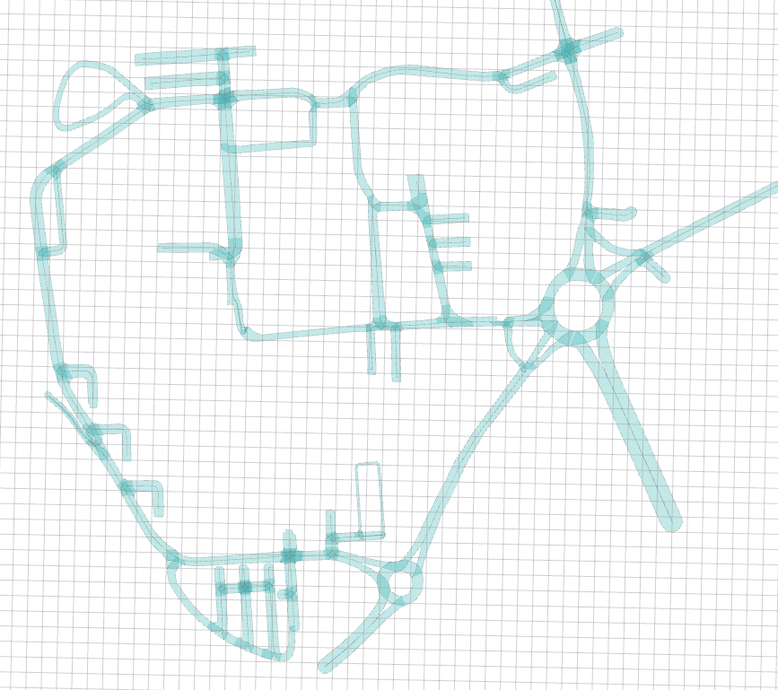

# Győr University Campus lanelet



## Versions

### 2026-07-20 (latest)

Transformed `2026.01.16.` with:
- `t_x` : `+0.97`m 
- `t_y` : `-0.33`m 
- `yaw` : `+0.33`°


### 2026-01-16 
First version. Version is defined by date, which is in ISO 8601 standard `YYYY-MM-DD`.


# Győr University Campus pointcloud

Transforming **2026-01-16** verison with +0.97m, -0.33m, +0.33° (0.0057595865rad):

```c
pcl_transform_point_cloud \
  /home/dev/autoware_map/gyor_campus/pointcloud_map_orig.pcd \
  /home/dev/autoware_map/gyor_campus/pointcloud_map.pcd \
  -trans 0.970,-0.330,0 \
  -axisangle 0,0,1,0.0057595865
```

- JKK dataset landing page: [jkk-research.github.io/latest/dataset](https://jkk-research.github.io/latest/dataset)
- Zenodo DOI: [doi.org/10.5281/zenodo.21871328](https://doi.org/10.5281/zenodo.21871328) [](https://doi.org/10.5281/zenodo.21871328)
- Zenodo record: [zenodo.org/record/21871328](https://zenodo.org/record/21871328) 

### Download

Either from Zenodo: [https://doi.org/10.5281/zenodo.21871328](https://doi.org/10.5281/zenodo.21871328) or directly with `wget`:

```bash
wget -O pointcloud_map_2026_07_20.pcd  "https://zenodo.org/records/21871328/files/pointcloud_map_2026_07_20.pcd?download=1"
```
```bash
wget -O lanelet2_map_2026_07_20.osm  "https://zenodo.org/records/21871328/files/lanelet2_map_2026_07_20.osm?download=1"
```

Alternatively, use Autoware naming conventions (`pointcloud_map.pcd` and `lanelet2_map.osm` in a separate directory):

```bash
wget -O pointcloud_map.pcd  "https://zenodo.org/records/21871328/files/pointcloud_map_2026_07_20.pcd?download=1"
```
```bash
wget -O lanelet2_map.osm  "https://zenodo.org/records/21871328/files/lanelet2_map_2026_07_20.osm?download=1"
```


# Images

